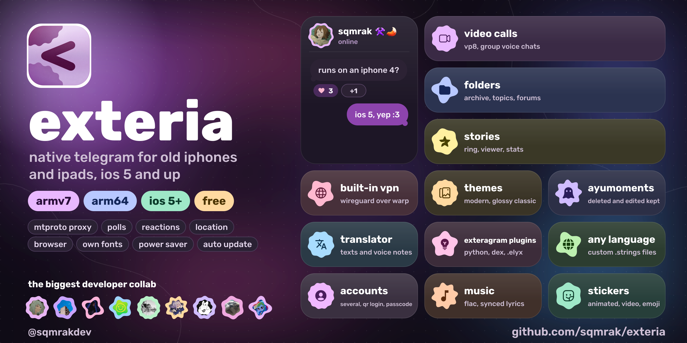

# exteria

<p align="center">
  
</p>

<p align="center"><b>native telegram for old iphones and ipads: ios 5 and up, calls with video, stories, folders, its own vpn</b></p>

> [!NOTE]
> the ipa is signed with ldid, so it installs on a jailbroken device.

## devices

- armv7: ios 5 and later
- arm64: ios 7 and later
- iphone and ipad, one binary with both slices

## features

- chats, folders, archive, stories, polls, reactions, custom emoji
- reactions use the icons and animations of the server: still icons on the chips, a pop in the picker, a burst when one is put on a message. a free account keeps one reaction per message, Premium up to the limit the server names (3)
- stickers: static, animated and video
- voice notes, round videos, gifs, files, albums, flac music
- location picker and nearby places, OpenStreetMap previews
- calls: voice and video (vp8); voice chats of groups and channels, audio only
- translator: telegram, services and ai
- passcode lock, several accounts, login by phone or qr
- keeps deleted and edited messages on the phone, if you ask for it
- ayumoments: copies of protected messages from chats the account can read
- two looks: modern, and classic with the glossy ios 5 and 6 style and a hue of your own (ios 5 to 10)
- `.tgios-theme` files in the modern look
- in-app browser for web links, a sheet that slides up and is pulled down to close
- a font file of your own (`.ttf` or `.otf`) or Rubik for the whole app, in chat settings
- plugins, power saver, local notifications
- russian, english

## themes

open a `.tgios-theme` file in Exteria, or copy it to Documents and choose it in chat settings. a `t.me/addtheme/<slug>` link works too. the preview shows both bubbles before applying.

- limits: 256 KiB, 512 values, 16 nesting levels
- colors reach the lists, bars, search, tabs, chat input and bubbles; missing values use the Exteria palette
- gradients of up to four colors are drawn static; wallpaper slugs, patterns and motion are not reproduced
- classic has its own palette

## shiro

the vpn of the app and of no other app: a wireguard tunnel to cloudflare warp inside the process.

- the button is in the chat list
- only telegram links and the udp of calls go through it, ipv4 only
- with the vpn on, connections wait for the tunnel and never fall back to the direct path
- the warp account is made on the first start over tls checked against `resources/shiro/roots.pem`

## browser

web links open in exteria, the system browser, or an installed chrome, firefox or brave, as chosen in the main settings. telegram links stay in the app.

## proxy

add a `tg://proxy`, `tg://socks`, `t.me/proxy` or `t.me/socks` link on the welcome screen or in more settings.

- mtproto: plain, `dd` and `ee` secrets; socks5: username and password
- up to 64 links, kept in the keychain or in `Application Support/Exteria/proxy-link`
- telegram connections use the proxy, through shiro when it is on; calls and web pages do not

## plugins

python plugins in the exteraGram format (`.plugin` or `.py`) in `Documents/Plugins`, listed in settings. the app runs cpython 3.11 and the sdk of [exteraless](https://github.com/exteraless/exteraless) over a small host. a plugin runs after the person turns it on and has seen the permissions it needs. the switch is tied to the sha-256 of the file, and three failed calls in a row switch it off. a tap on a running plugin opens the page of settings it builds.

- works: `BasePlugin`, hooks for sent messages and for new ones, a page of settings from `create_settings()`, dialogs and notices, android views in an overlay, https, the standard library
- does not work: request hooks of tl, `org.telegram.*` and `android.*` classes outside the shim, `fork`, `subprocess`. such a plugin is listed and fails on import with the class it lacks
- a plugin runs inside the app with the rights of the app, a permission is shown to the person and is not a wall

the host is `core/pyhost`, the python side is `python/shim` and `third_party/exteraless`, the hooks into the chat are `app/platform/exteria_plugins.m`.

## for developers

- [docs/languages.md](docs/languages.md): add a language, from a `.strings` file or built into the app
- [docs/plugins.md](docs/plugins.md): write and port a python plugin

## build

```bash
make test
bash scripts/build_sticker_codecs.sh
make ipa
```

needs `EXTERIA_TC EXTERIA_SDK_V7 EXTERIA_SDK_V64 EXTERIA_OPENSSL_V7 EXTERIA_OPENSSL_V64 EXTERIA_LDID`, optional `EXTERIA_CRT_V7`. api id and hash come from `local/credentials.env` (`EXTERIA_API_ID`, `EXTERIA_API_HASH`). output: `build/ios/Exteria-v<version>.ipa`.

- `make test-video`: video decoders under asan and ubsan, needs ffmpeg libraries, pkg-config and libvpx
- `make app-unsigned`, then `make inspect-unsigned`: both slices, deployment targets, frameworks and ios 5 imports; needs `EXTERIA_SDK_V5` and `EXTERIA_SDK_V6`
- video stickers and calls link static ffmpeg and libvpx: set `EXTERIA_FFMPEG_SOURCE`, `EXTERIA_LIBVPX_SOURCE`, `EXTERIA_VIDEO_V7` and `EXTERIA_VIDEO_V64`, see `resources/licenses/video_stickers.txt`

## install

```bash
scp -r build/ios/Exteria.app root@<device-ip>:/Applications/
ssh root@<device-ip> 'chown -R mobile:wheel /Applications/Exteria.app && su mobile -c uicache'
```

the owner must be `mobile:wheel`, or the app cannot change its own icon on ios 6.

on ios 5 and 6 an app in `/Applications` gets no banners, no notification center entry and no settings row, because springboard gives notification settings to user apps only. after the copy run

```bash
ssh root@<device-ip> '/Applications/Exteria.app/Exteria --system-notifications on'
```

before `uicache`, then respring. it adds the `SBInternalAppTag` to the bundle's `Info.plist` and sets `SBShowInternalApps` in the springboard preferences (without it the icon of an internal app is hidden); `off` takes the preference back. the deb runs this in its postinst and postrm, and the in-app update runs it again after it replaces the files. an ipa installed as a user app (ipainstaller, appsync) and the rootless `/var/jb` install need nothing, and ios 7 and later are left alone by the command.

## updates

on start the app asks `api.github.com` for the latest release and shows a notice when its tag is newer. a release needs `Exteria-v<version>.ipa` and `Exteria-v<version>.ipa.sha256`, the tag is `v<version>`.

- the update replaces the files of the running bundle on a writable jailbreak install in `/Applications`, `/var/jb/Applications` or the user app folder `/var/containers/Bundle/Application` (an ipa installed with ldid keeps the entitlement that allows the write; an apple-signed install does not, and its write probe fails); other installs open the release page
- the ipa must match its digest, or nothing is installed
- limits: 128 MiB, 4096 entries, four https redirects to github hosts

## paths

- accounts: `Library/Application Support/Exteria/exteria-<id>.db`
- warp account: `Library/Application Support/Exteria/shiro.account`
- crash log: `/var/mobile/Library/Caches/exteria-crash.log`
- call trace: `/var/mobile/Documents/exteria-call-trace.log`
- frame log: `Library/Caches/exteria-perf.log`, on with `defaults write com.sqmrak.exteria exteria.perf -bool YES`

to resolve app frames in a copied crash log, use the executable of the exact reported build and architecture (needs `llvm-objdump` and `llvm-addr2line`):

```bash
python3 scripts/symbolicate_crash.py crash.log /path/to/Exteria --arch armv7
```

## license

[exteria license](LICENSE). rights already granted under [gpl v3](LICENSE.gpl-3.0) remain in effect. the emoji pack is apple artwork and is not licensed for redistribution, see `resources/emoji/NOTICE.txt`. fonts, codecs and sounds keep their licenses in `resources/licenses` and `resources/fonts`.
