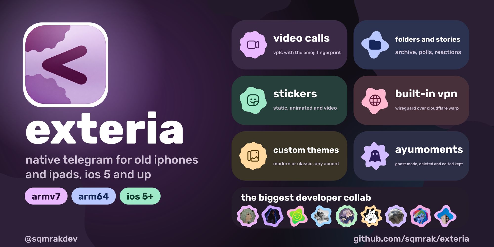

# exteria

<p align="center">
  
</p>

<p align="center"><b>native telegram for old iphones and ipads: ios 5 and up, calls with video, stories, folders, its own vpn</b></p>

> [!NOTE]
> the ipa is signed with ldid, so it installs on a jailbroken device.

## devices

- armv7: ios 5 and later
- arm64: ios 7 and later
- iphone and ipad, one binary with both slices

## features

- chats, folders, archive, stories, polls, reactions, custom emoji
- stickers: static, animated and video
- voice notes, round videos, gifs, files, albums
- location picker, nearby places and search, OpenStreetMap previews in messages
- calls: voice and video (vp8), emoji fingerprint
- voice chats of groups and channels: join, start, leave, mute, invite link and `?videochat=` links, audio only. no video, screen sharing, live streams or encrypted conferences (`t.me/call/...`)
- translator: telegram, services and ai
- passcode lock: four digits or a password, auto-lock
- keeps deleted and edited messages on the phone, if you ask for it
- several accounts, login by phone or qr
- two looks: modern, and classic with the glossy ios 5 and 6 style and a hue of your own
- power saver, quiet background link, local notifications
- russian, english

location uses OpenStreetMap tiles with attribution, a 48-entry and 12 MiB memory cache, and a 32 MiB disk cache. nearby places use Telegram's venue search bot. map requests follow the Shiro route.

## shiro

the vpn of the app and of no other app. a wireguard tunnel to cloudflare warp that lives in the process:

- the button is in the chat list (a pill in the modern look, a bar button with a lamp in the classic one)
- only the connections of the app go through it: telegram links and the udp of calls
- ipv4 only, ipv6 reflectors are skipped
- with the vpn on, connections wait for the tunnel and never fall back to the direct path
- the warp account is made on the first start over tls checked against `resources/shiro/roots.pem`

## proxy

add a `tg://proxy`, `tg://socks`, `t.me/proxy` or `t.me/socks` link on the welcome screen or in more settings. mtproto accepts plain, `dd` and `ee` secrets; socks5 accepts a username and password. the selected link is stored in the keychain. telegram message and file connections use the proxy, through shiro when it is enabled. calls and web pages use shiro or the direct route, not the proxy.

## ipad

- after sign in the lists stand on the left and what they open on the right
- one column of content, clear of the notch and the home indicator

## build

```bash
make test
bash scripts/build_sticker_codecs.sh
make ipa
```

needs `EXTERIA_TC EXTERIA_SDK_V7 EXTERIA_SDK_V64 EXTERIA_OPENSSL_V7 EXTERIA_OPENSSL_V64 EXTERIA_LDID`, optional `EXTERIA_CRT_V7`. api id and hash come from `local/credentials.env` (`EXTERIA_API_ID`, `EXTERIA_API_HASH`). output: `build/ios/Exteria-v<version>.ipa`.

- `make test-video`: vp9 sticker decoder and the vp8 call codec under asan and ubsan, needs ffmpeg libraries, pkg-config and libvpx with vp8
- `make app-unsigned`, then `make inspect-unsigned`: both slices, deployment targets, frameworks and ios 5 imports. needs `EXTERIA_SDK_V5` and `EXTERIA_SDK_V6`
- video stickers and calls link static ffmpeg and libvpx: set `EXTERIA_FFMPEG_SOURCE` and `EXTERIA_LIBVPX_SOURCE` to the sources listed in `resources/licenses/video_stickers.txt`, point `EXTERIA_VIDEO_V7` and `EXTERIA_VIDEO_V64` at the result

## install

```bash
scp -r build/ios/Exteria.app root@<device-ip>:/Applications/
ssh root@<device-ip> 'chown -R mobile:wheel /Applications/Exteria.app && su mobile -c uicache'
```

the owner must be `mobile:wheel`, or the app cannot change its own icon on ios 6.

## updates

on start the app asks `api.github.com` for the latest release and shows a notice when its tag is newer than `CFBundleShortVersionString`. the update button downloads the ipa, checks it, and replaces the files of the running bundle:

- a release needs two assets: `Exteria-v<version>.ipa` and `Exteria-v<version>.ipa.sha256` (`sha256sum` output). the tag is `v<version>`. without both, the notice only opens the release page
- the download follows at most four redirects, each one https to `github.com` or a single label under `githubusercontent.com`, checked against the roots in the bundle. the ipa must match the digest, or nothing is installed
- only files that differ are written. they are inflated into `Exteria.app/.update` first and moved over the old ones when all of them check out, the executable and `Info.plist` last. files the new ipa no longer has stay where they are
- the app folder must be writable by the app (`mobile:wheel`, see install). otherwise the notice says so and opens the release page
- after the last file the app runs `uicache` if it is there, and asks for a restart
- limits: 128 MiB for the ipa, 4096 entries, no zip64, no links, no encryption

## paths

- accounts: `Library/Application Support/Exteria/exteria-<id>.db`
- folders: `Library/Application Support/Exteria/chat-folders.tl`
- warp account: `Library/Application Support/Exteria/shiro.account`
- crash log: `/var/mobile/Library/Caches/exteria-crash.log`
- call trace: `/var/mobile/Documents/exteria-call-trace.log`
- frame log: `Library/Caches/exteria-perf.log`, on with `defaults write com.sqmrak.exteria exteria.perf -bool YES`

exception reports include the system's stack symbols. to resolve app frames in a copied crash log, use the executable from the exact reported build and architecture:

```bash
python3 scripts/symbolicate_crash.py crash.log /path/to/Exteria --arch armv7
```

the script needs `llvm-objdump` and `llvm-addr2line` and checks the build uuid before resolving frames. keep the executable or matching debug symbols for each build.

## license

[exteria license](LICENSE). rights already granted under [gpl v3](LICENSE.gpl-3.0) remain in effect. the emoji pack is apple artwork and is not licensed for redistribution, see `resources/emoji/NOTICE.txt`. fonts, codecs and sounds keep their licenses in `resources/licenses` and `resources/fonts`.
